# 📸 The 90's Photobooth

> *Step into the booth, draw the curtain, and experience the nostalgic, imperfect magic of 1980s and 1990s analog photo booths.*

[](https://www.python.org/)
[](https://flask.palletsprojects.com/)
[](https://opencv.org/)
[](https://python-pillow.org/)

---

## 🎞️ Overview

Before smartphones, filters, and unlimited retakes, photo booths were an event. You sat on an adjustable swivel stool, dropped coins into a slot, waited for the blinding flash, and received a wet, chemical strip of prints after an agonizing mechanical hum. 

**The 90's Photobooth** is an interactive web-based photobooth app built with **Flask**, **OpenCV**, and **Pillow**. It recreates not just the vintage look, but the **authentic friction and suspense** of physical booths from that era.

---

## ✨ Features

### ⚡ Authentic 90s Photobooth Friction
- **The "3-3-3" Capture Cycle**: 3 photos, 3-second countdown before each shot, 3-second intervals.
- **The Blind Spot (No Cheating!)**: 500 milliseconds before each flash, the live viewfinder freezes. You have to commit to your pose without seeing the final frame.
- **Blinding Strobe Flash**: A simulated high-intensity flash (`#FFFFFF`) with synchronized shutter audio.
- **Mechanical Developing Wait**: A 10-second chemical development animation where your print gradually resolves from blank, foggy silver-halide paper into full color to the sound of an internal mechanical motor.

### 🎨 Analog Film Processing Pipeline
- **Warm "Golden Hour" Film Matrix**: Custom color transformation matrix boosting reds and yellow-greens while dialing down blues to emulate warm Kodak/Fujifilm prints.
- **Micro Film Grain**: Poisson/Gaussian noise injection to simulate film grain structure.
- **Square 1:1 Aspect Ratio**: Automatic portrait center-cropping for genuine photo-strip proportions.
- **Digital Date Stamp**: Retro glowing orange 7-segment digital timestamp (`YYYY MMM DD`) burned into the bottom border with drop shadow.
- **Vintage Cardstock Border**: Realistic off-white textured border (`#E8E8E1`) with photo dividers.

### 🎛️ Modes & Layouts
| Mode | Description |
| :--- | :--- |
| **Standard Strip** | Classic single 3-photo booth strip. |
| **Twin Print** | Side-by-side duplicate strip with a perforated cut line (one for you, one for your best friend). |
| **Combine Sessions** | Upload an earlier strip to stitch alongside your new session. |
| **Ghost Exposure** | Blends an uploaded strip with your newly captured shots as a dreamy double exposure. |

Supports both **Vertical** (classic tall strip) and **Horizontal** layouts.

---

## 🛠️ Tech Stack

- **Backend**: Python 3, [Flask](https://flask.palletsprojects.com/) (Serverless-ready for Vercel)
- **Image Processing**: [Pillow (PIL)](https://python-pillow.org/), [NumPy](https://numpy.org/) (pure lightweight Python/NumPy matrix transforms, 0 system library dependencies)
- **Frontend**: HTML5, CSS3 (CRT scanline shader, retro typography), Vanilla JavaScript (WebRTC MediaDevices API, Canvas API)
- **Audio & Assets**: Web Audio API / HTML5 Audio (shutter snap, mechanical whirring, retro digital fonts)

---

## 📁 Project Structure

```text
90's-Photobooth/
├── app.py                 # Flask server & API endpoints (with 4.5MB payload defense)
├── processor.py           # Pillow + NumPy color transform matrix, grain, & JPEG strip assembly
├── setup_assets.py        # Asset downloader & synthetic sound generator
├── requirements.txt       # Lean Python dependencies (Flask, Pillow, numpy)
├── vercel.json            # Vercel Python serverless configuration
├── .vercelignore          # Files excluded from Vercel deployment bundle
├── README.md              # Project documentation
│
├── assets/                # Server-side committed font assets (Digital-7.ttf)
├── public/                # Edge-served static files (CSS, fonts, audio)
│   ├── style.css
│   └── assets/
│       ├── CourierPrime-Regular.ttf
│       ├── Digital-7.ttf
│       ├── shutter.wav
│       └── mechanical_whirr.wav
│
├── templates/
│   └── index.html         # Photobooth UI, camera stream, countdown & state machine
│
└── Plan/                  # Architecture, PRD, and design specifications
```
└── Plan/                  # Architecture, PRD, and design specifications
```

---

## 🚀 Getting Started

### 1. Prerequisites
- Python **3.8+** installed.
- A functional webcam.

### 2. Clone / Navigate to the Directory
```bash
cd "c:\Users\laksh\OneDrive\Documents\Vibe Projects\90's-Photobooth"
```

### 3. Install Dependencies
```bash
pip install -r requirements.txt
```

*(Optional: If you use a virtual environment)*
```bash
python -m venv venv
# Windows:
.\venv\Scripts\activate
# Linux/macOS:
source venv/bin/activate
pip install -r requirements.txt
```

### 4. Setup Assets (Fonts & Sounds)
Ensure assets are downloaded and generated:
```bash
python setup_assets.py
```

### 5. Launch the Server
```bash
python app.py
```

### 6. Open in Browser
Visit either:
- **[http://127.0.0.1:5000](http://127.0.0.1:5000)**
- **[http://localhost:5000](http://localhost:5000)**

Allow camera permissions when prompted by your browser.

---

## 🌐 Deploy to Vercel

The project is preconfigured for zero-friction deployment to Vercel Serverless:

### Option A: Via GitHub (Recommended)
1. Push your repository to GitHub (`https://github.com/ghost-react/90-s-Photobooth`).
2. Go to [Vercel Dashboard](https://vercel.com/dashboard) and click **"Add New"** > **"Project"**.
3. Import the `90-s-Photobooth` repository.
4. Leave Framework Preset as **Other** (Vercel automatically detects `vercel.json` and `@vercel/python`).
5. Click **Deploy**.

### Option B: Via Vercel CLI
```bash
npm i -g vercel
vercel
# Follow prompts, then deploy to production:
vercel --prod
```

---

## 🕹️ How to Use

1. **Select Mode & Layout**:
   - Choose **Standard Strip**, **Twin Print**, **Combine Sessions**, or **Ghost Exposure**.
   - If using **Combine** or **Ghost**, click **Choose File** to upload a previously saved photo strip.
   - Choose **Vertical** or **Horizontal** orientation.
2. **Initiate Capture**: Click the green **INITIATE CAPTURE** button.
3. **Strike a Pose**:
   - A 3-second countdown will start for each of the 3 photos.
   - Notice the feed freezes 0.5 seconds before each snap—hold your pose!
   - Hear the mechanical shutter and watch the flash illuminate.
4. **Development Phase**:
   - Wait ~10 seconds while the booth's internal mechanical whirr plays and the photo develops from a pale fog into rich vintage color.
5. **Save or Repeat**:
   - Click **SAVE STRIP** to download your high-resolution `.png` photo strip.
   - Click **START OVER** to step back into the booth.

---

## 🔬 Under the Hood: Image Pipeline

```mermaid
flowchart LR
    A[Webcam Capture Base64] --> B[Crop to 1:1 Square]
    B --> C[Contrast & Saturation Boost]
    C --> D[Color Matrix: Warm Golden Hour]
    D --> E[Film Grain Injection]
    E --> F[Stitch into Border Canvas]
    F --> G[Render Orange Digital Timestamp]
    G --> H[Advanced Mode: Twin / Ghost / Combine]
    H --> I[Developed Base64 Output]
```



1. **Aspect Ratio Adjustment**: Crops rectangular video inputs to a square 1:1 frame.
2. **Color Profile Transformation**:
   $$\begin{bmatrix} R' \\ G' \\ B' \end{bmatrix} = \begin{bmatrix} 1.15 & 0.15 & 0.00 \\ 0.05 & 1.10 & 0.00 \\ 0.00 & 0.00 & 0.85 \end{bmatrix} \begin{bmatrix} R \\ G \\ B \end{bmatrix}$$
3. **Film Grain**: Gaussian distribution noise scaled to $15\%$ intensity and clamped to valid 8-bit dynamic range.
4. **Border & Date Burning**: Formatted on an off-white paper canvas with digital clock font rendering simulated phosphor bleeding.

---

## 📜 License

Created for nostalgic souls and vibe coding enthusiasts. Open source and free to use for personal and educational projects.
